# STYX Status

Generated by scripts/status.py from evidence/. Do not edit by hand.

```mermaid
flowchart LR
    subgraph Pipeline_gates[Pipeline gates]
        G0["G0 Scope and safety<br/>BLOCKED"]
        G0 --> G1
        G1["G1 Data path<br/>NOT_RUN"]
        G1 --> G2
        G2["G2 Accounting<br/>NOT_RUN"]
        G2 --> G3
        G3["G3 Paper smoke test<br/>NOT_RUN"]
        G3 --> G4
        G4["G4 Operational safety<br/>NOT_RUN"]
        G4 --> G5
        G5["G5 Protocol freeze<br/>DEFERRED"]
        G5 --> G6
        G6["G6 Evidence review<br/>NOT_RUN"]
    end
    subgraph Research_loop[Research loop]
        R1["R1 Call registry<br/>NOT_RUN"]
        R1 --> R2
        R2["R2 Scan to JSON<br/>NOT_RUN"]
        R2 --> R3
        R3["R3 Grader v2<br/>NOT_RUN"]
        R3 --> R4
        R4["R4 Scoreboard<br/>NOT_RUN"]
        R4 --> R5
        R5["R5 Research AI v2<br/>NOT_RUN"]
        R5 --> R6
        R6["R6 Promotion<br/>NOT_RUN"]
    end
    G4 -.-> R1

    classDef pass fill:#2e7d32,color:#fff;
    classDef fail fill:#c62828,color:#fff;
    classDef blocked fill:#f57f17,color:#fff;
    classDef not_run fill:#757575,color:#fff;
    classDef deferred fill:#bdbdbd,color:#fff,stroke-dasharray: 5 5;
    class G0 blocked;
    class G1 not_run;
    class G2 not_run;
    class G3 not_run;
    class G4 not_run;
    class G5 deferred;
    class G6 not_run;
    class R1 not_run;
    class R2 not_run;
    class R3 not_run;
    class R4 not_run;
    class R5 not_run;
    class R6 not_run;
```

## Status Table

| Step | State | Recorded | Blockers |
|------|-------|----------|----------|
| G0 | BLOCKED | 2026-11-08 | - No local OpenAlgo installation or installed-version documentation is available; Analyzer Mode isolation is UNVERIFIED. - Part A and Part B have not been run. |
| G1 | NOT_RUN | — | — |
| G2 | NOT_RUN | — | — |
| G3 | NOT_RUN | — | — |
| G4 | NOT_RUN | — | — |
| G5 | DEFERRED | — | — |
| G6 | NOT_RUN | — | — |
| R1 | NOT_RUN | — | — |
| R2 | NOT_RUN | — | — |
| R3 | NOT_RUN | — | — |
| R4 | NOT_RUN | — | — |
| R5 | NOT_RUN | — | — |
| R6 | NOT_RUN | — | — |

**Next:** G0 Scope and safety (BLOCKED) — No local OpenAlgo installation or installed-version documentation is available; Analyzer Mode isolation is UNVERIFIED.
